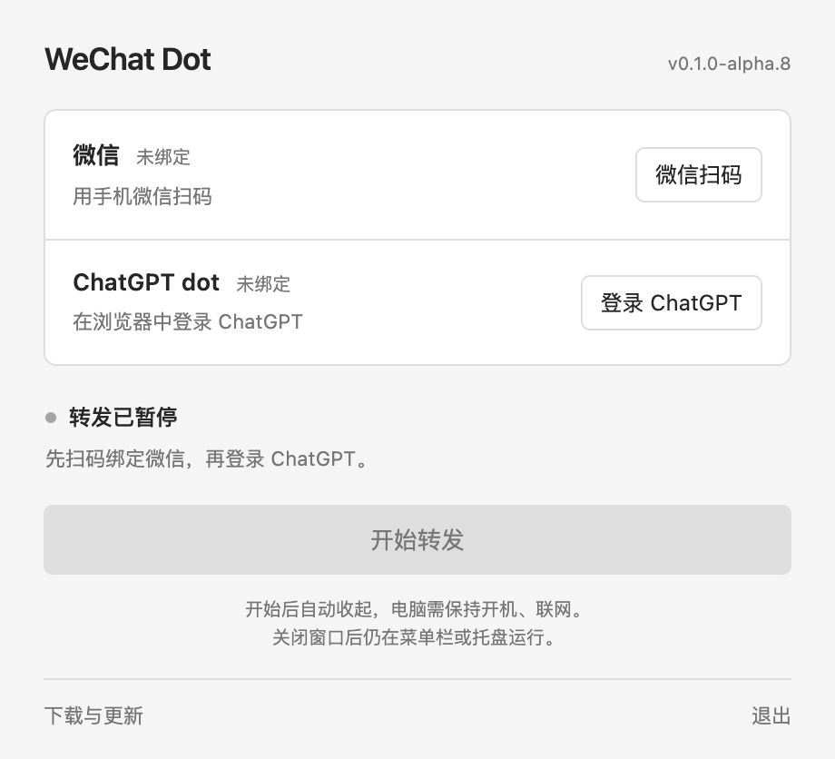

在微信里和你的 dot 聊天。

[下载安装包](https://github.com/Yugo616/wechat-dot/releases/latest)

免费开源，运行在你的 Mac 或 Windows 电脑上。连接你已有的 ChatGPT dot，不需要另购 API 或租服务器。

基于腾讯的 [openclaw-weixin](https://www.npmjs.com/package/@tencent-weixin/openclaw-weixin) 改造，沿用微信扫码和消息收发，把原来连接 OpenClaw 的一端换成你自己的 ChatGPT dot。

安装前准备：

- 电脑：Mac 或 Windows，能正常打开 ChatGPT，账号里已有可用的 dot。
- 手机：安装微信，用来扫码绑定和聊天。**电脑不用安装微信。**

安装只需三步：

1. 下载并打开安装包。
2. 扫微信二维码，登录 ChatGPT。
3. 点击「开始转发」。

账号绑定一次即可；平时只用「开始转发／暂停转发」。

不用另装 Chrome、浏览器扩展或 Node，也不用填写 API Key。首次登录时会自动下载专用浏览器，窗口里能看到进度。

文字、连续对话、dot 主动消息已在 Mac 上实测。图片、文件、语音输入已接入，真实收发仍在测试。详细进度见[验证记录](docs/testing.md)。

1.0.4 修复了登录后切换窗口导致连接失败的问题。登录完成后直接沿用当前窗口，本机已恢复连接。

### 电脑要一直开着吗？

要保持开机、联网、不休眠。关机、休眠或退出程序后，微信和 dot 之间会停止收发。只关掉连接窗口没关系，程序仍在 Mac 菜单栏或 Windows 托盘里运行。

点击「退出」时，可以选择「最小化」继续在后台运行，或「退出后台」停止收发。勾选「不再询问」会记住选择；菜单栏或托盘里可以恢复询问。

### 为什么多了一个浏览器窗口？

标有「WeChat Dot 专用」的是程序的登录窗口，使用独立的 Chrome for Testing，图标带有「Test」字样。它与日常 Chrome 分开运行；点击平时的 Chrome 图标仍打开原来的浏览器。连接后专用窗口自动收起，需要时在软件里点「打开专用窗口」。

从 1.0.2 或更早版本升级，需要在新窗口里重新登录一次 ChatGPT。微信绑定和 dot 对话保留。

### 怎么更新？

点左下角「检查更新」，有新版会自动下载，完成后点「重启更新」。优先下载差分，首次更新或差分不可用时下载完整包；账号和聊天进度保留。

旧预览版需先下载安装一次正式版。当前只检查正式版本。

### 重新开机后，要重新扫码吗？

通常不用。当前版本不会开机自启，开机后打开 WeChat Dot 即可。上次处于连接状态、登录仍有效时，会自动恢复连接，接着原来的上下文聊。

如果之前点了「暂停转发」，重新打开后仍会暂停。点「开始转发」即可，程序会先检查保存的登录，不用每次扫码。

### 断网后会自动恢复吗？

会。消息收发失败时显示实际尝试次数和下一次重试倒计时，不用反复点按钮。请求还没结束时显示正在尝试；浏览器意外退出也会自动恢复。登录过期时，提示旁会出现「重连微信」或「重连 dot」。

### 会突然补发很久以前的消息吗？

只续传最近 10 分钟的消息。超过 10 分钟，没送出的微信问题和 dot 回复会自动跳过，窗口显示「已跳过 X 条过期消息」。重启、断网恢复都按这条规则，不用手动清理；需要继续旧问题时，在微信里再发一次即可。

附件失败会单独重试，新的问题和文字回复继续收发。原来 dot 的聊天记录和上下文保留。

### 用的是我原来的 dot 吗？

是，连接你已有的 dot，接着原来的上下文聊。

### 提示「微信暂时拒收回复」怎么办？

保持连接，在**手机微信**里给机器人再发一句话，程序会自动继续，补送最近 10 分钟内的回复。此时新的微信问题仍能送到 dot。不需要在电脑上安装或打开微信，也不用重新扫码。

### 首次打开被系统拦住怎么办？

当前安装包尚未签名。macOS 在「系统设置 → 隐私与安全性」中选择「仍要打开」；Windows 点击「更多信息 → 仍要运行」。

### 登录过期了怎么办？

点击提示旁的「重连微信」或「重连 dot」，扫码或完成登录即可；ChatGPT 登录后点「登录完成」。原先正在转发的连接会自动继续，不用再点「开始转发」。

[开发说明](docs/development.md) · [上游版权](THIRD_PARTY_NOTICES.md) · [MIT](LICENSE)
